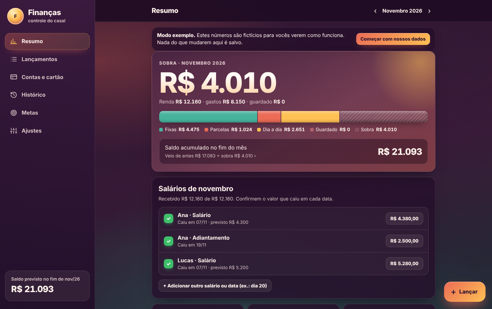
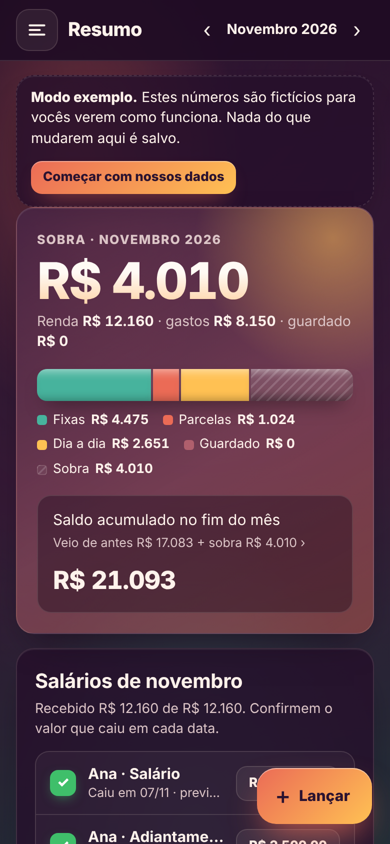
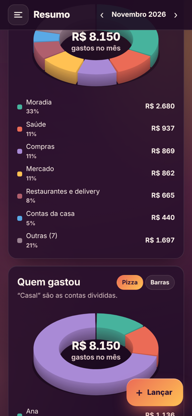
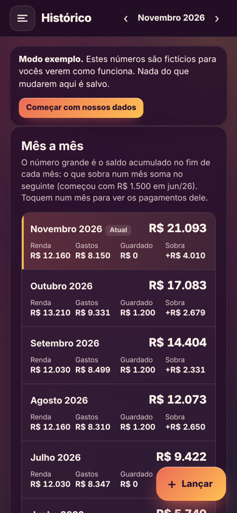

# Finanças · controle financeiro do casal

Aplicativo web para um casal controlar juntos os gastos do mês, as contas fixas, o cartão de crédito parcelado e os salários, e planejar metas de compra e de poupança. Funciona no celular e no computador, com login e sincronização ao vivo entre os dois aparelhos.



<p align="center">
  
  
  
  
</p>

## Funcionalidades

- **Resumo do mês**: sobra, divisão da renda (fixas, parcelas, dia a dia, guardado e sobra) e saldo acumulado, em que a sobra de cada mês soma no seguinte.
- **Salários por data**: cada pagamento é cadastrado com a data em que cai (5º dia útil ou dia fixo). Todo mês o casal confirma o valor que realmente caiu.
- **Lançamentos**: Pix, débito, dinheiro, boleto e cartão de crédito à vista ou parcelado (até 24x), com escolha do mês da fatura. A categoria é sugerida pela descrição ou pelo último lançamento igual.
- **Contas fixas e fatura do cartão**: marcar como pago, aviso de conta vencida, número de cada parcela ("5 de 10") e projeção do que já está comprometido nos próximos 12 meses.
- **Histórico**: mês a mês com renda, gastos, guardado, sobra e saldo, mais o registro de tudo que foi pago e recebido.
- **Plano do mês**: compara os gastos com a regra 50/30/20 e gera alertas (limite estourado, categoria que subiu muito, ritmo de gasto, parcelas comprometendo a renda, parcela que termina).
- **Metas**: valor e data desejada. O app calcula quanto guardar por mês e por semana, divide entre os dois proporcionalmente aos salários e, se não couber, sugere em que categorias cortar e quanto, ou uma nova data possível. Também calcula a reserva de emergência ideal.
- **Gráficos**: pizza 3D (desenhada em SVG, sem biblioteca), barras empilhadas e colunas dos últimos meses, com dicas ao tocar.
- **Backup**: baixar, copiar e importar todos os dados em JSON.

## Tecnologias

| Parte | Escolha |
|---|---|
| Interface | HTML, CSS e JavaScript puros, sem framework e sem etapa de build |
| Login e banco de dados | [Supabase](https://supabase.com): autenticação por e-mail e senha, Postgres com Row Level Security e Realtime |
| Hospedagem | [Vercel](https://vercel.com), como site estático |
| Gráficos | SVG e CSS feitos à mão |

### Decisões técnicas

- **Cálculo do 5º dia útil** com feriados nacionais, incluindo os móveis (Carnaval, Sexta-feira Santa e Corpus Christi), calculados a partir da data da Páscoa. Há a opção de contar o sábado como dia útil, que é a regra da CLT para salário. Pagamentos em dia fixo que caem em fim de semana ou feriado vão para o dia útil anterior.
- **Projeção de metas**: considera as contas fixas e as parcelas de cada mês futuro (parcela que termina libera dinheiro) mais a média do gasto do dia a dia dos últimos 3 meses. Depois desconta o que as outras metas já pedem.
- **Escrita otimista**: a tela atualiza na hora e a gravação acontece em seguida. Se a gravação falhar, o app recarrega os dados do servidor.
- **Sincronização ao vivo**: o Supabase Realtime avisa o outro aparelho a cada mudança.
- **Três modos de dados**: Supabase (com login), local (no navegador, quando não há configuração) e exemplo (dados fictícios para conhecer o app).
- **Desempenho no celular**: o fundo animado troca de cor só por opacidade, sem desfoque em tempo real, e as animações respeitam a opção de reduzir movimento do sistema.

## Estrutura

```
public/                 site publicado
  index.html
  css/style.css
  js/app.js             lógica do app
  js/config.js          URL e chave pública do Supabase (gerado no deploy)
  js/vendor/            cliente do Supabase
scripts/gerar-config.js gera o config.js a partir das variáveis da Vercel
supabase/schema.sql     tabela, regras de segurança e realtime
vercel.json             build e pasta publicada
```

## Como colocar no ar

### 1. Supabase (banco e login)

1. Crie uma conta gratuita em [supabase.com](https://supabase.com) e um projeto novo.
2. Em **SQL Editor › New query**, cole o conteúdo de `supabase/schema.sql` e clique em **Run**.
3. Em **Authentication › Sign In / Providers › Email**, desligue **Allow new users to sign up**. Assim ninguém além de vocês consegue criar conta.
4. Em **Authentication › Users › Add user › Create new user**, crie uma conta para cada pessoa (e-mail e senha) e marque **Auto Confirm User**.
5. Em **Authentication › URL Configuration**, coloque o endereço do site da Vercel em **Site URL**. Isso faz o link de "Esqueci minha senha" funcionar.
6. Em **Project Settings › API**, copie a **Project URL** e a chave **anon public**.

### 2. Vercel (site)

1. Em [vercel.com](https://vercel.com), clique em **Add New › Project** e importe este repositório do GitHub.
2. Em **Environment Variables**, adicione:
   - `SUPABASE_URL`: a Project URL
   - `SUPABASE_ANON_KEY`: a chave anon public
3. Clique em **Deploy**. O `vercel.json` já define o build e a pasta `public`.

A chave "anon" do Supabase é pública por natureza. Quem protege os dados são as regras de Row Level Security: só usuários logados leem e escrevem, e o cadastro público fica desligado.

### Rodar no computador

```bash
npx serve public
```

Sem configuração, o app roda em modo local, com os dados guardados no navegador. Para testar com login, preencha `public/js/config.js` com a URL e a chave do Supabase.

## Migrar dados de outra instalação

Em **Ajustes › Dados**, use **Baixar backup** (ou **Copiar backup**) no lugar de origem e **Importar backup** no novo. Registros com o mesmo código são atualizados e nada é apagado.

## Créditos

Projeto desenvolvido com apoio de IA (Claude, da Anthropic) na escrita do código. As funcionalidades foram definidas e testadas a partir do uso real no dia a dia do casal.

Licença MIT.

---

## English summary

**Finanças** is a web app that helps a couple track monthly spending, fixed bills, credit card installments and paychecks, and plan savings goals. Built with vanilla HTML/CSS/JS (no framework, no build step), Supabase (email/password auth, Postgres with Row Level Security, Realtime sync between devices) and deployed on Vercel as a static site.

Highlights: Brazilian business-day payday calculation including movable holidays derived from Easter; goal planning that projects future installments and suggests category cuts or a feasible new date; hand-made 3D SVG donut charts; optimistic writes with server resync; local and demo modes when no backend is configured; JSON backup export/import.
